<div align="center">

# Indrajith Bandara

**CYBERSECURITY · NETWORKING**

**CLOUD · OPEN SOURCE**


[Portfolio](https://indrajithbandara.is-a.dev/) · [LinkedIn](https://www.linkedin.com/in/indrajithbandara) · [Repositories](https://github.com/indrajithbandara?tab=repositories)

</div>

---


### `help` — Command index

[whoami](#01--whoami) · [projects](#02--ls-projects)  
[skills](#03--cat-skillsconf) · [credentials](#04--ls-credentials)  
[network](#05--cat-academy-networkconf) · [activity](#06--git-log--activity)  
[contact](#07--cat-contactconf)

### `neofetch`

```text
PROFILE OS     Modern Terminal 5.0
FOCUS          Security / Network
               Cloud
ENVIRONMENT    Linux / Open Source
DATA SOURCE    GitHub public API
SYNC           Daily scheduled refresh
```

## 01 / `whoami`


```console
guest@indrajith:~$ whoami
Indrajith Bandara

guest@indrajith:~$ cat profile.conf
location = Sri Lanka
focus    = Security / Networking
           Cloud
mission  = Technology education
shell    = Open source
```

Advisor (ASC/IT) at Excellence Oriented Support & Training Center, acting on behalf of Cisco Networking Academy, as described in my professional profile.

My work and interests span cybersecurity education, Cisco instructor training, networking, cloud computing, programming education, technical mentoring and open-source development.

## 02 / `ls ./projects`


### [Untouched: Privacy Lock](https://github.com/indrajithbandara/Privacy-Lock-App)

Android privacy and application-locking project built with Kotlin and Jetpack Compose. Focused on authentication, privacy and secure application access.

`Android` · `Kotlin` · `Privacy` · `Security`

[Source code](https://github.com/indrajithbandara/Privacy-Lock-App) · [Releases](https://github.com/indrajithbandara/Privacy-Lock-App/releases)

### [Undisturbed](https://github.com/indrajithbandara/undisturbed)

Network privacy engineering project exploring tracker detection and Android VPN-based protection.

`Android` · `Network privacy` · `Tracker protection`

[Source code](https://github.com/indrajithbandara/undisturbed) · [Development activity](https://github.com/indrajithbandara/undisturbed/pulls)

### [Professional Technology Platform](https://indrajithbandara.is-a.dev/)

Personal portfolio and professional technology platform.

`Web` · `Personal branding` · `Open source`

[Live website](https://indrajithbandara.is-a.dev/) · [Source code](https://github.com/indrajithbandara/indrajithbandara.github.io)

## 03 / `cat skills.conf`


- **Security:** Cybersecurity, ethical hacking, network security, Fortinet, Palo Alto
- **Networking:** Cisco, network infrastructure
- **Cloud:** AWS Academy, Oracle Cloud, VMware, Red Hat
- **Development:** Python, JavaScript, C, C++, Kotlin, Bash
- **Systems:** Linux, Kali Linux, Ubuntu
- **Tooling:** Git, GitHub, VS Code
- **Emerging technology:** AI, privacy engineering

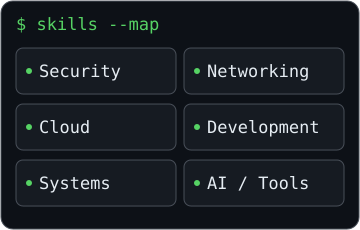

## 04 / `ls ./credentials`


- 🎖️ **CCEP** — Certified Cybersecurity Educator Professional
- ☁️ **Oracle Cloud** — Oracle Cloud Foundations Certified
- 🔐 **APIsec Ambassador** — APIsec University Ambassador
- 🤖 **AI Frontier** — AI Frontier Network Member
- 🎓 **CodePath Mentor** — CodePath Mentor Network
- 🏆 **220+ Badges** — Digital Credentials across Security, Cloud & Networking

### Achievement milestones (dates not supplied)

`Cybersecurity education` → `Cloud foundations` → `Professional communities` → `Technical mentoring`

The sequence groups achievements by theme, not chronological order.

## 05 / `cat academy-network.conf`


Academy and learning ecosystem affiliations listed in my professional profile:


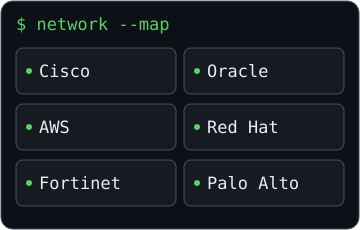

## 06 / `git log --activity`


<!-- metrics:start -->

Public repositories: **2855** · Followers: **1471**

- **[Privacy-Lock-App](https://github.com/indrajithbandara/Privacy-Lock-App)**
  - Open issues & PRs: 10 · Stars: 1
  - Last push (UTC): 2026-11-25
- **[indrajithbandara.github.io](https://github.com/indrajithbandara/indrajithbandara.github.io)**
  - Open issues & PRs: 1 · Stars: 0
  - Last push (UTC): 2026-11-26

Account created: **2016-10-21**

### Latest public engineering activity

- [Privacy-Lock-App / f1b7f16](https://github.com/indrajithbandara/Privacy-Lock-App/commit/f1b7f162737d503722cd434475e701b24c260f06) — 2026-06-28
- [indrajithbandara.github.io / 055c480](https://github.com/indrajithbandara/indrajithbandara.github.io/commit/055c480d3d683f5dfa46fc03f3aaa729ec44e3ab) — 2026-11-26

### Project health monitor

- **[Privacy-Lock-App](https://github.com/indrajithbandara/Privacy-Lock-App)**
  - [No latest stable release reported](https://github.com/indrajithbandara/Privacy-Lock-App/releases)
  - See check results
- **[indrajithbandara.github.io](https://github.com/indrajithbandara/indrajithbandara.github.io)**
  - [No latest stable release reported](https://github.com/indrajithbandara/indrajithbandara.github.io/releases)
  - See check results

Check results are not a security or production-readiness guarantee.

Source: GitHub API. Last push is activity, not a release or security certification.

<!-- metrics:end -->

### Contribution skyline

<!-- skyline:start -->

**638 contributions** · **41 active days** · **108 peak daily count**

<!-- skyline:end -->

The skyline visualizes daily activity. For accessible counts and dates, use the [GitHub contribution calendar](https://github.com/indrajithbandara).

[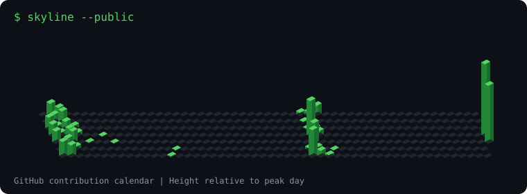](https://github.com/indrajithbandara)

[View contribution history and repository activity](https://github.com/indrajithbandara)

## 07 / `cat contact.conf`


[](https://www.linkedin.com/in/indrajithbandara)
[](https://github.com/indrajithbandara)
[](https://x.com/HeyIndrajith)
[](https://youtube.com/@IndrajithBandara)
[](https://dev.to/indrajithbandara)
[](mailto:indrajithbandarasl@gmail.com)

---

```console
guest@indrajith:~$ echo $MISSION
Build with purpose. Learn continuously.
guest@indrajith:~$ _
```

<sub>Modern Terminal 5.0 · Professional engineering profile</sub>
